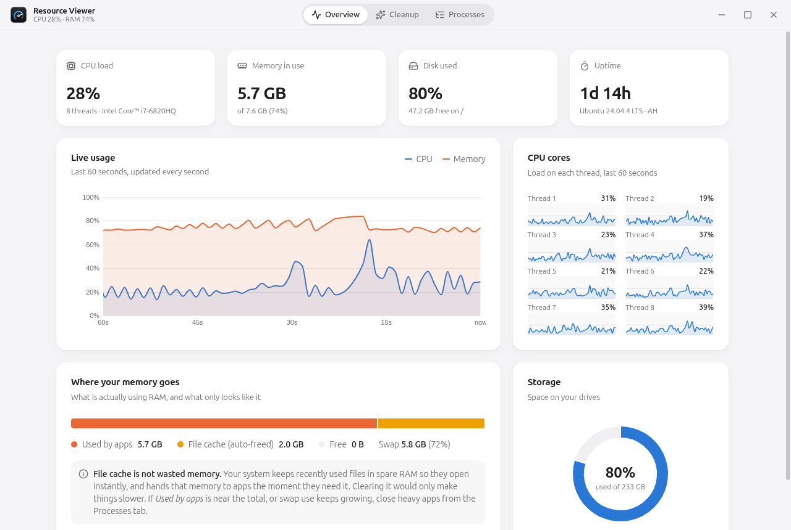
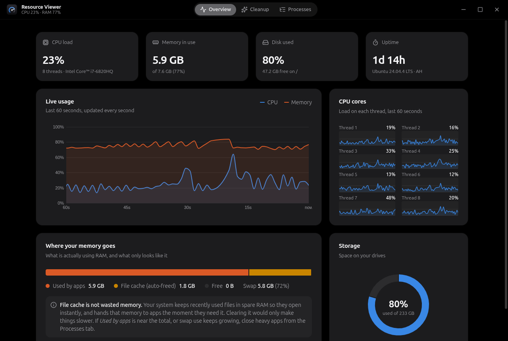
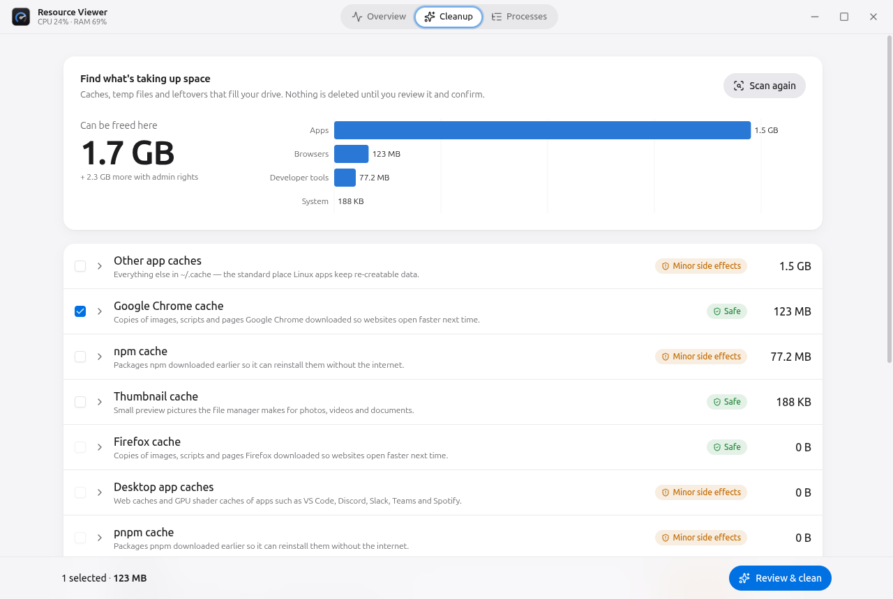
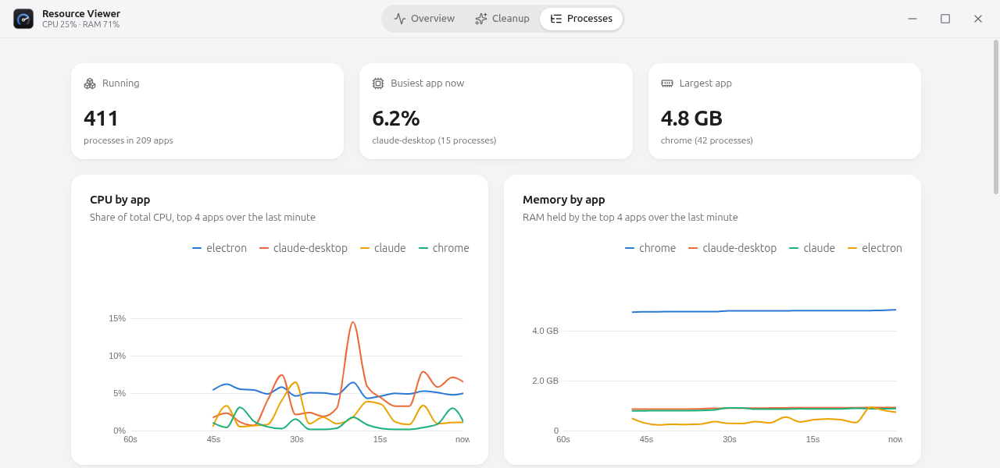

<div align="center">


# Resource Viewer

**See what slows your computer down — and clean it with a clear view of what you give up.**

Windows · Linux · macOS

</div>

<br />

<p align="center">
  
</p>

## Why Resource Viewer

Most cleaners tell you how much space you'll free. Few tell you what you lose.
Resource Viewer shows both, for every item, before anything is deleted — and only
pre-selects what is genuinely safe.

- **Honest cleanup.** Each item explains *what it is*, *what you gain* and *what you might lose*, with a clear risk level.
- **Live system view.** CPU, memory, per-thread load, disks and running apps, updated in real time.
- **Safe by design.** Strict allow-list, no symlink following, in-use files skipped, nothing touched without confirmation.
- **Native feel.** A minimal interface that follows your system's light or dark appearance.

## Features

### Overview



- Live CPU and memory chart covering the last 60 seconds
- One live graph per CPU thread
- Memory breakdown that separates RAM used by apps from file cache the system frees on its own
- Disk usage for every drive

### Cleanup



Scan finds re-creatable data and groups it by category. Expand any item to read what it
is, what you gain and what you might lose; the confirmation dialog repeats every loss
before cleaning.

| Risk | Meaning | Selected by default |
|---|---|---|
| **Safe** | Rebuilt automatically. You won't notice. | Yes |
| **Minor side effects** | Something is slower or downloads again once. | No |
| **Think first** | Removed permanently or costly to get back. | No |

Items that need administrator rights (system logs, package caches, Windows Update files)
are measured and shown with the exact command to run yourself.

<details>
<summary><strong>What it can clean</strong></summary>

<br />

| Category | Items |
|---|---|
| Browsers | Chrome, Edge, Brave, Firefox, Chromium, Opera, Vivaldi — cache only; cookies, passwords, history and bookmarks are never touched |
| Apps | Desktop app caches (VS Code, Discord, Slack, Teams, Spotify…), `~/.cache` (Linux), `~/Library/Caches` (macOS) |
| Developer tools | npm, pnpm, Yarn, pip, Go and Gradle caches, Xcode DerivedData, downloaded AI models |
| System | Thumbnail cache, crash reports, app logs |
| Temp files | Your own temporary files untouched for more than 24 hours |
| Trash | Trash / Recycle Bin |

The full catalogue for each platform lives in [`src/main/targets.ts`](src/main/targets.ts).

</details>

### Processes



- Live CPU and memory graphs for the four heaviest apps
- Apps grouped by name, so a browser's dozens of processes count as one
- **End process** asks the app to close normally first. Background processes on Windows can be force-ended after a second confirmation.

## Download & install

Download the file for your platform from the `dist/` folder (or your release page).

| Platform | File | Install |
|---|---|---|
| **Windows 10 / 11** | `ResourceViewer-Setup-<version>.exe` | Run the installer. Adds Start-menu and desktop shortcuts; uninstall from **Settings → Apps**. |
| | `ResourceViewer-Portable-<version>.exe` | No installation — double-click to run. |
| **Ubuntu / Debian** | `resource-viewer_<version>_amd64.deb` | `sudo apt install ./resource-viewer_<version>_amd64.deb`, then open **Resource Viewer** from the app menu. |
| **Other Linux** | `ResourceViewer-<version>.AppImage` | `chmod +x ResourceViewer-*.AppImage` and run it. |
| **macOS** | `Resource Viewer-<version>.dmg` | Open the disk image and drag the app to **Applications**. Must be built on a Mac — see below. |

> [!NOTE]
> The app is not code-signed yet. On first launch Windows shows **"Windows protected your PC"** —
> choose **More info → Run anyway**. On macOS, right-click the app and choose **Open**.

## Safety

Cleaning runs in the main process against a fixed allow-list. The interface only ever sends
item IDs — never file paths.

- Only the **contents** of an allowed folder are removed — never the folder itself, never anything outside it (checked before every delete).
- Symbolic links are removed as links; their targets are never followed.
- Sockets, pipes and devices are skipped, so running tools such as `ssh-agent` and `tmux` keep working.
- Temporary files are only removed when they belong to you and haven't changed for 24 hours.
- Locked or protected files are skipped and counted, not forced.
- Hard-linked files (for example the pnpm store) are counted as 0 bytes, because deleting them frees nothing.

## Development

**Requirements:** Node.js 22 or later and npm.

```bash
npm install
npm run dev
```

| Command | Description |
|---|---|
| `npm run dev` | Start the app with hot reload |
| `npm run build` | Compile main, preload and renderer into `out/` |
| `npm start` | Run the compiled app |
| `npm run typecheck` | Type-check all processes |
| `npm run dist:win` | Build the Windows installer and portable app (from Linux, via Docker) |
| `npm run dist:win:native` | Build for Windows on a Windows machine |
| `npm run dist:linux` | Build the `.deb` and AppImage |
| `npm run dist:mac` | Build the `.dmg` and `.zip` for Intel and Apple Silicon (on a Mac) |
| `npm run icons` | Regenerate every app icon (requires Python 3 and Pillow) |

Build output is written to `dist/`.

### Building for Windows from Linux

The NSIS installer step needs a 32-bit-capable Wine, so `npm run dist:win` runs
electron-builder inside the official `electronuserland/builder:wine` Docker image.
Docker is the only requirement; output files are owned by your user.

### Building for macOS

Apple's packaging and signing tools only run on macOS:

```bash
npm install && npm run dist:mac
```

## Architecture

```
src/
├── main/                 Electron main process
│   ├── index.ts          Window, IPC handlers, custom title bar controls
│   ├── metrics.ts        CPU, memory, disks and processes (systeminformation)
│   ├── targets.ts        Cleanup catalogue per platform, with gain / loss / risk text
│   ├── cleaner.ts        Scanner and cleaner with the safety rules above
│   ├── cleanWorker.ts    Runs scans and cleans on a worker thread
│   └── jobs.ts           One job at a time; concurrent scans share a result
├── preload/              Typed, context-isolated bridge (window.api)
├── shared/               Types shared by every process
└── renderer/             React interface
    ├── features/         Overview, Cleanup, Processes
    └── components/       LiveChart (D3 on canvas), window controls, shadcn/ui
```

**Performance.** The scanner walks folders with synchronous file-system calls on a worker
thread — about 3 seconds for 400,000 files, versus roughly a minute with one
asynchronous call per file — so the interface never blocks. Live charts are drawn with
D3 onto a `<canvas>` on each animation frame, without re-rendering React, and pause when
the window is hidden.

**Security.** The renderer runs sandboxed with context isolation and no Node.js access,
under a strict Content Security Policy.

### Tech stack

| | |
|---|---|
| Shell | Electron 45, electron-vite, electron-builder |
| Interface | React 19, TypeScript, Tailwind CSS 4, shadcn/ui |
| Charts | D3 (live canvas charts), Recharts via shadcn/ui charts |
| System data | systeminformation |

## App icon

Every icon is generated by [`scripts/make-icons.py`](scripts/make-icons.py), so all
platforms share one design. Sizes of 32 px and below are drawn separately with thicker
strokes to stay sharp.

| File | Used for |
|---|---|
| `build/icon.ico` | Windows executable, installer and taskbar (16–256 px) |
| `build/icon.icns` | macOS Dock and Finder (all slots, 16–1024 px) |
| `build/icons/` | Linux app menu and dock (16–1024 px) |
| `resources/icon.png` | Linux window icon at runtime |

## Troubleshooting

<details>
<summary><strong>Ubuntu 24.04: "The SUID sandbox helper binary was found, but is not configured correctly"</strong></summary>

<br />

This only affects `npm run dev` and the AppImage. Ubuntu 24.04 restricts the sandbox
Chromium uses. The `.deb` package configures it automatically. For development, either
fix it once:

```bash
sudo chown root:root node_modules/electron/dist/chrome-sandbox
sudo chmod 4755 node_modules/electron/dist/chrome-sandbox
```

or run `npm run dev:nosandbox`. Start the AppImage with `--no-sandbox`.

</details>

<details>
<summary><strong>Some files were skipped during cleaning</strong></summary>

<br />

Files that are in use are left alone on purpose. Close the related app — usually the
browser — and clean again.

</details>

<details>
<summary><strong>macOS: the Trash shows 0 bytes</strong></summary>

<br />

macOS protects the Trash. Give Resource Viewer **Full Disk Access** in
**System Settings → Privacy & Security**.

</details>

---

<p align="center"><sub>© 2026 Ali Hamza</sub></p>
